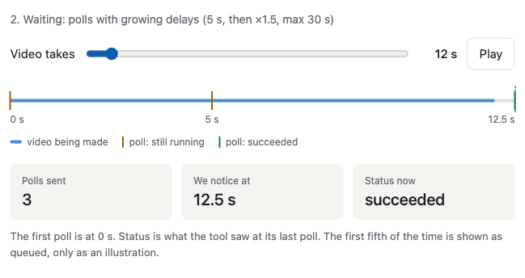
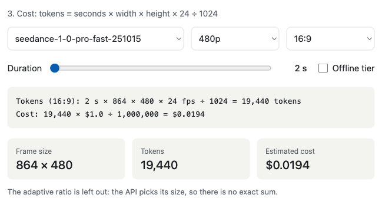

# Seedance client

A small Python client and command-line tool for Seedance video generation on
BytePlus ModelArk.

**This is an independent sample. It is not affiliated with BytePlus.**

No setup needed to look: open [how it works](docs/how-it-works.html) in a browser.

## How it works

### Flow

[](docs/how-it-works.html)

| Command | Costs money | What it does |
|---------|-------------|--------------|
| `estimate` | no | Shows the cost. No key, no network. |
| `create` | yes | Asks first, then sends one request that is never retried. |
| `wait` | no | Reads the task until it ends. |
| `download` | no | Saves the video. Sends no key to the storage host. |

The full path, with the journal, is in the diagram under [First call](#first-call).

### Waiting

[](docs/how-it-works.html)

The tool reads the task at once, then after 5 s. Each pause is 1.5 times the last, up to 30 s. More in [Design decisions](#design-decisions).

### Estimate

[](docs/how-it-works.html)

```
Tokens (16:9): 2 s × 864 × 480 × 24 fps ÷ 1024 = 19,440 tokens
Cost: 19,440 × $1.0 ÷ 1,000,000 = $0.0194
```

The formula and its limits are under [Cost](#cost).

The pictures are static; open `docs/how-it-works.html` in a browser for the interactive version.

## Overview

It estimates the cost, sends one paid request, waits for the video and
downloads it. For a plain-language version, read
[CUSTOMER_GUIDE.md](CUSTOMER_GUIDE.md). For problems, read
[TROUBLESHOOTING.md](TROUBLESHOOTING.md). The facts behind the code, with
sources and dates, are in [docs/API_NOTES.md](docs/API_NOTES.md). An interactive
page explains the flow, the waiting and the cost:
[docs/how-it-works.html](docs/how-it-works.html).

## Setup

1. Install [uv](https://docs.astral.sh/uv/), then run:

   ```bash
   uv sync
   ```

2. In the BytePlus ModelArk console, region `ap-southeast-1`:
   - create an API key
   - activate the model you want

   Keys and activation are separate per region. Seedance runs in
   `ap-southeast-1` only. The 2.5 and 2.0 models also need USD 30 of available
   balance, or a savings plan or resource pack of USD 30 or more.

3. Copy `.env.example` to `.env` and put your key in it. The name must be
   `ARK_API_KEY`:

   ```
   ARK_API_KEY=your-key
   ```

   Git ignores `.env`. `uv run --env-file .env` loads it. To use no file, run
   `export ARK_API_KEY=your-key` instead.

## First call

See the cost. This needs no key and no network:

```bash
uv run seedance estimate --model seedance-1-0-pro-250528 --resolution 480p --ratio 16:9 --duration 5
```

Send one paid request. It shows the estimate and asks first:

```bash
uv run --env-file .env seedance create --model seedance-1-0-pro-250528 --resolution 480p --ratio 16:9 --duration 5 --prompt "A paper boat on a calm lake at sunrise"
```

Wait until it ends:

```bash
uv run --env-file .env seedance wait
```

Save the video:

```bash
uv run --env-file .env seedance download
```

`wait` and `download` find the task ID in the journal. If you stop `wait` or
`download`, run the same command again. Running `create` again makes a new paid
request.

```
 estimate          (no key, no network)
    |
    v
 create ---> check the request ---> check the key
                                        |
                                        v
             open attempt in the journal? --yes--> stop until you check
                                        | no       the task list
                                        v
             show the cost, ask y/N
                                        | yes
                                        v
             journal: submitting
                                        |
                                        v
 POST, once, never retried
    |
    +-- 2xx with an ID ------------> journal: created  (task ID saved)
    |
    +-- not connected, or a 4xx ---> journal: rejected (we assume no task)
    |   with an error code
    |
    +-- no clear answer -----------> journal: unknown  (the attempt is open:
                                                        the next create stops)

 wait ---> GET task: queued -> running -> succeeded | failed | expired | cancelled
    |
    v
 journal: finished (tokens, cost)
    |
    v
 download ---> GET task (gives the video link)
                  |
                  v
               GET video link (no key sent) ---> outputs/TASK_ID.mp4
```

## Commands

| Command | What it does |
|---------|--------------|
| `estimate --model --resolution --ratio --duration [--service-tier] [--image-url]` | Shows the cost calculation. No key. |
| `create` + the same options, `[--prompt] [--yes] [--resolved]` | Sends one paid request. |
| `status [TASK_ID] [--json]` | Reads a task once. |
| `wait [TASK_ID] [--timeout SECONDS]` | Reads a task until it ends. |
| `download [TASK_ID] [--output PATH] [--overwrite]` | Saves the video. |

- Without `TASK_ID`, the newest task in the journal is used.
- `--prompt` is required for text to video. With `--image-url`, the image is
  the first frame and the prompt is optional.
- `--service-tier flex` is offline: half price, hours of delay, 1.0 models only.
- `--yes` accepts the cost without a question. It is refused if the price is
  unknown. It never clears an unclear earlier create.
- `--resolved` says that you checked the task list after an unclear create. Use
  it only after you did. See "After an unclear create".
- `status --json` prints the video link. Anyone with the link can use it, so do
  not share that output.

### After an unclear create

List your tasks with the List tasks API. Set `ARK_API_KEY` in the shell first
(`export`): `uv run --env-file` does not set it there.

Online tasks:

```bash
curl -H "Authorization: Bearer $ARK_API_KEY" "https://ark.ap-southeast.bytepluses.com/api/v3/contents/generations/tasks?page_num=1&filter.service_tier=default"
```

Offline (`flex`) tasks:

```bash
curl -H "Authorization: Bearer $ARK_API_KEY" "https://ark.ap-southeast.bytepluses.com/api/v3/contents/generations/tasks?page_num=1&filter.service_tier=flex"
```

Each tier has its own list. The API shows online tasks only, unless you ask for
`flex`. The tool names the tier of the open attempt. If you are not sure, check
both. A page holds 20 tasks by default. More pages may exist: raise `page_num`
until a page is empty.

If your console shows a task list, you can check there too. If the task exists,
use its ID with `wait` and `download`. Then use `--resolved` on your next
`create`.

Each error class has its own exit code. They are listed in
[errors.py](src/seedance_client/errors.py).

## Design decisions

**Every cost driver is an explicit choice.** Model, resolution, ratio and
duration have no defaults. The 1.0 models default to 1080p, about 5 times the
480p cost.

**Task, then polling.** The API answers a create with a task ID, not a video.
This tool asks for the task again until it ends. The API can also call a URL of
yours (`callback_url`), but that needs a public web server. A command-line tool
has none. A server product should consider callbacks.

**Create is sent once and never retried.** The create call has no idempotency
key (an ID that lets a server ignore a repeat). If an answer is lost, the first
request may already be running. A second send can make a second paid video. So
an unclear result stops the tool and asks you to list your tasks. We assume that
a 4xx answer with an error code means no task was made. The docs do not say so.

**The journal.** `~/.seedance/journal.jsonl` gets a line before the request and a
line right after the answer. A run that dies between them leaves an open
attempt, and the next `create` sees it. It holds your prompt, never the key or
the video link. It is one file per user, not per folder, so a `create` in
another folder sees the open attempt too. Set `SEEDANCE_HOME` (a full path) to
use another folder. Run one `create` at a time: the journal has no lock.

**Dated price file.** Prices are in
[pricing.toml](src/seedance_client/data/pricing.toml) with the date and source.
A price change needs no code change. A missing price shows as "price unknown".

**Checks before paying.** Wrong options are rejected before any request, all
problems at once.

**Error classes.** Errors map by the code in the answer first, then by HTTP
status. Each one shows what happened, what to do next, the code and the request
ID. Reads are retried only for rate limits, server errors and network faults.

**Key handling.** The key comes from `ARK_API_KEY` only. It goes to the ARK
address only. That client follows no redirects. Downloads use a second client
without the key. Error texts never hold request headers.

**Layers.** `cli` calls `client`. `client` calls `transport` and `journal`. The
rules (`validation`, `pricing`, `catalog`) do no network calls.

**Polling and retry numbers are our choices, not from the docs:** first poll
after 5 s, growing by 1.5 up to 30 s, 900 s in total. Reads get up to 5 tries
with delays of 1, 2, 4 and 8 s. A numeric `Retry-After` header is used instead,
up to 60 s. Timeouts: connect 10 s, read 30 s, create read 60 s. Downloads get
up to 3 tries. Retry delays never pass the `wait` limit. A single read in progress can, by its
own HTTP timeout.

## Cost

```
tokens = seconds × width × height × 24 ÷ 1024
cost   = tokens × price per million ÷ 1,000,000
```

Example: `seedance-1-0-pro-250528`, 480p, 16:9, 5 s:
5 × 864 × 480 × 24 ÷ 1024 = 48,600 tokens. At $2.5 per million that is $0.1215.
Estimate from the list prices read on 2026-11-23 at
[ModelArk pricing](https://docs.byteplus.com/en/docs/modelark/model-pricing).

With `--ratio adaptive` the API picks the size. The tool shows an indication from
the six standard shapes, not a bound. For example, 2.5 first-frame image to video
keeps the shape of your image, which may match none of the six.

The bill uses the token count in the API answer. After success the tool shows
that count and a cost "computed from list price". The tool cannot show the billed
amount. In the console, Billing overview shows the account balance and Usage
statistics shows token usage (S11 in the notes). To cap
spending, set a cumulative usage limit per model (S15). When it is reached, calls
return 429 `SetLimitExceeded`. The docs say only successful videos are charged.

## Verified run

One paid run. All tests use fake HTTP.

| Item | Value |
|------|-------|
| Date | 2026-11-24, created 05:45:15 UTC |
| Task ID | `cgt-2026****` |
| Model | `seedance-1-0-pro-fast-251015` |
| Parameters | text to video, 480p, 16:9, 2 s, tier `default` |
| Prompt | "A paper boat drifts across a calm pond at sunrise" |
| Estimate | 19,440 tokens, $0.0194 |
| Actual `usage.completion_tokens` | 19,845 |
| Cost computed from list price (not the billed amount) | $0.0198 |
| Created to succeeded (`updated_at` minus `created_at`) | 12 s |
| File | MP4, 864×480, 24 fps, 49 frames, 1,223,272 bytes |

The actual count is 405 tokens (2.1%) above the estimate. The file has 49 frames,
not 2 × 24 = 48, and one 864×480 frame is 864 × 480 ÷ 1024 = 405 tokens. So the
difference equals one extra frame. This is one run: we do not know if every
video gets one. The estimate still uses the documented formula.

An earlier create was refused with `ModelNotOpen` because the model was not
activated. No task was made. The tool recorded `rejected`.

## Known limits

- Images: one public URL, used as the first frame. No upload.
- The image itself is not checked (format, size, dimensions, faces). A URL does
  not show these. The API checks them.
- No automatic duration (`-1`): its cost cannot be estimated.
- No video, audio or reference inputs.
- On macOS, `os.fsync` does not guarantee that the data is on disk after a power
  loss. A journal line could then be lost.
- Ctrl-C in the instant between the answer and the code that saves it can lose
  the task ID. The attempt stays open. List your tasks.
- No cancel command. The API cancels only queued tasks.

Not confirmed by the docs we read:

- what the storage host returns for an expired link, and whether a new read of
  the task gives a fresh link. We assume that HTTP 403 and 404 mean expired
  or over the download limit
- whether a 4xx with an error code means no task was made. We assume it does
- whether HTTP 429 answers carry `Retry-After`
- the balance rules for the 1.0 models, and whether an account gets the free
  quota
- the error body. It was observed in a probe, not documented
- how long a video usually takes. The docs give no number. Our one run took 12 s

The full list is in [docs/API_NOTES.md](docs/API_NOTES.md), section 12.

## Development

```bash
uv run pytest -q
```

```bash
uv run ruff check .
```

Tests need no key and no network. A test that opens a real connection fails.

## License

MIT. See [LICENSE](LICENSE).
